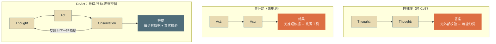
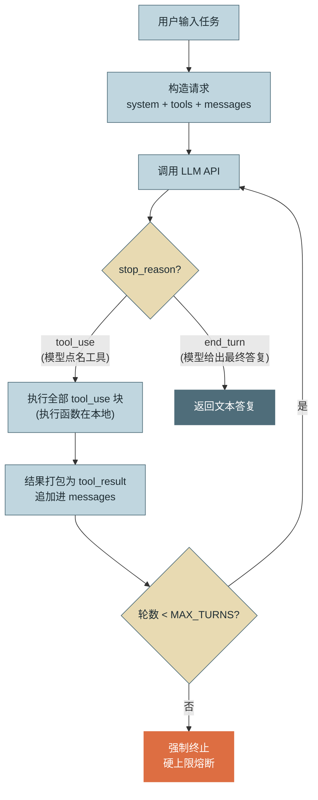
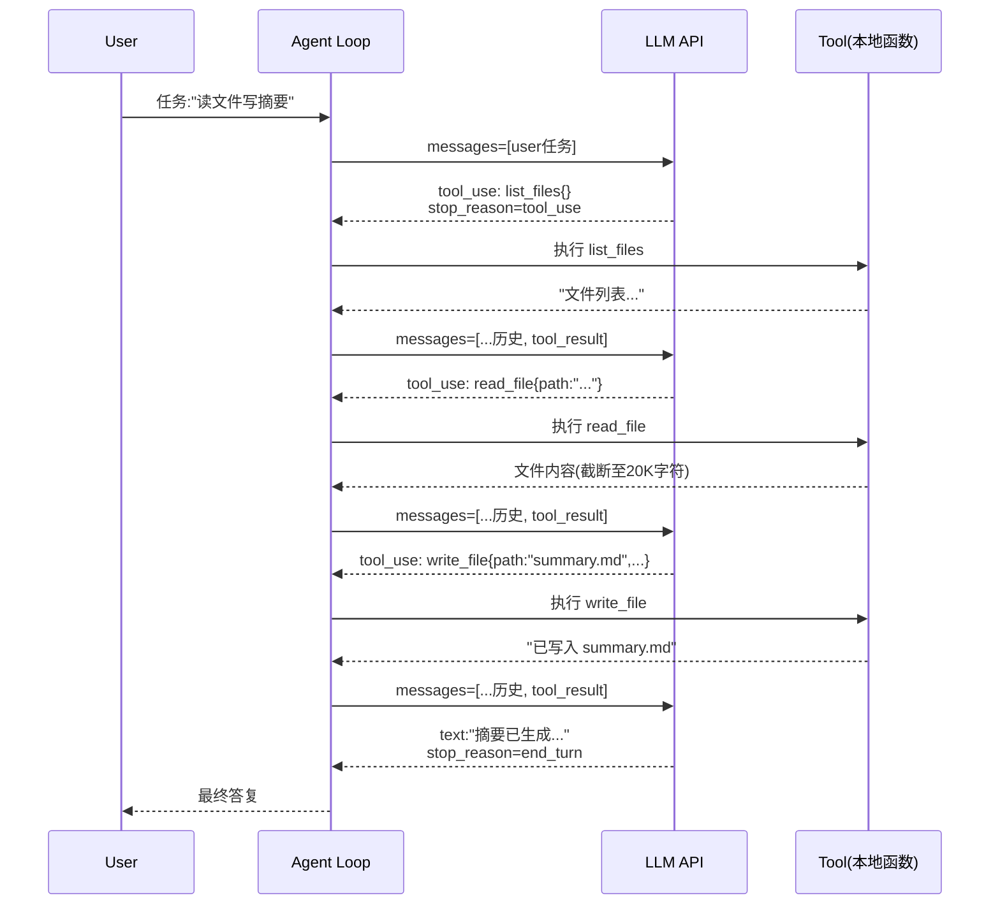

# 第2章 第一个Agent

## 1. 场景引入：“祛魅”时刻

> “不用 `LangChain`，不使用任何 Agent 框架，你能否用任何语言现场写出一个能完成多部任务的 Agent ？”

Agent 总伴随着 `AgentExecutor`、`Chain`、`Memory` 一堆抽象类出现。但这个问题的本质是：

> “把框架剥掉，Agent 的最小可运行形态到底有几行？其中每一行都在做什么？””

此问题考察的核心为：**心智模型**：是否理解 Agent 的本质只是：**一个调用 LLM API 的 while 循环，循环体里执行模型点名的工具**。

理解这一点，任何框架都只是这个循环的封装变体。

## 2. 原理

### 2.1 `ReAct`：推理与行动的交替

`ReAct (Reasoning + Acting)`由 2022 年的论文 *ReAct: Synergizing Reasoning and Acting in Language Models* 中提出，核心思想是让模型交替产生**推理轨迹（Thought）和行动（Acting）**，行动的**观察结果（Observation）**再反馈给下一轮推理。

相比“只推理”（如纯`CoT`，容易幻觉出不存在的事实）和“只行动（五规划，容易乱调工具）”，交替结构让每一步行动都有推理依据、每一步推理都有真是观察支撑——这正是第1章“教训二：无验证”的最小对策：**观察结果就是天然的验证信息**。



### 2.2 最小循环的四个部分

剥到最小，一个可运行的 Agent 只需要四部分：
1. **系统提示构造（System Prompt）**：定义 Agent 的身份、工作方式与约束。它决定模型“如何使用工具”，是行为的第一控制面。
2. **工具注册（Tool Registry）**：$工具 = 名称 + 描述 + 参数Schema + 本地执行函数$。前三者随着请求发送给模型（说明书），执行函数留在本地。
3. **循环驱动（Loop Driver）**：$调用LLM→检查响应→执行工具→回填结果→再调用$。对话历史（messages数组）就是循环的全部状态——这一点是理解一切 Agent 运行时的要是。
4. **中止判断（Termination）**：双保险——模型侧信号（`stop_reason`不再是`tool_use`，说明模型认为无需继续行动）+运行侧硬上限（`MAX_TURNS`），后者证实第1章`AutoGPT`无限循环教训的直接落地。


### 2.3 消息协议：一次三轮任务的完整时序

循环的每一轮在网络上是一次完整的 HTTP请求/响应，API本身无状态——历史由客户端（即循环）随每次请求全量重发。以“查文件→都内容→写报告”任务为例，完整消息时序如下：



## 3. 手动实现

```
agent-assistant/
├── pyproject.toml          # 仅依赖: requests
├── examples/
│   └── minimal_agent.py    # 本章单文件版，保留作教学参照
└── src/assistant/
    ├── core/
    │   ├── types.py        # 核心接口
    │   └── agent_loop.py   # AgentLoop：循环的类封装
    ├── tools/              # 每工具一模块
    │   ├── builtin.py      # 工具定义
    │   └── registry.py     # 工具注册
    └── llm/
        └── client.py       # call_llm 的封装
```

### 3.1 `types.py`
```python
"""
定义全书通用的核心接口，后续章节基本只增不改。
"""

from dataclasses import dataclass, field
from typing import Any, Callable, Literal, Protocol, Optional


class Tool(Protocol):
    """工具接口：描述信息给模型看，execute 在本地执行"""
    name: str
    description: str
    input_schema: dict[str, Any]

    def execute(self, input: dict[str, Any]) -> str: ...


@dataclass
class AgentEvent:
    """生命周期事件，用于 GUI 渲染或可观测性"""
    type: Literal["llm_call_start", "text", "tool_call", "tool_result", "done", "aborted"]
    turn: int
    payload: dict[str, Any] = field(default_factory=dict)


@dataclass
class AgentLoopOptions:
    """Agent 循环的配置选项"""
    system_prompt: str
    tools: list[Tool]
    max_turns: int
    on_event: Optional[Callable[[AgentEvent], None]] = None
```
其中：
- `AgentEvent`：底层和界面之间沟通的桥梁，将 Agent 运行过程中的所有状态，打包成一个标准化的消息盒子，扔给外部。
- `AgentLoopOptions`：`AgentLoop`的配置清单，定义系统提示词、可用工具、最大循环轮次、监听方法。

### 3.2 `agent_loop.py`
```python
"""
真正的循环核心。它不负责 HTTP 请求，也不负责具体工具逻辑，而是把 LLM 客户端和工具注册表组合起来，按 ReAct 模式驱动任务执行。
"""

import json
from typing import Any
from .types import AgentLoopOptions, AgentEvent
from ..llm.client import DeepSeekClient
from ..tools.registry import build_tool_registry, tools_to_wire


class AgentLoop:
    def __init__(self, opts: AgentLoopOptions):
        self.opts = opts
        self.tools_by_name = build_tool_registry(opts.tools)
        self.llm = DeepSeekClient()

    def _emit(self, event_type: str, turn: int, **payload: Any):
        if self.opts.on_event:
            self.opts.on_event(AgentEvent(type=event_type, turn=turn, payload=payload))

    def run(self, task: str) -> str:
        messages = [
            {"role": "system", "content": self.opts.system_prompt},
            {"role": "user", "content": task}
        ]

        for turn in range(1, self.opts.max_turns + 1):
            self._emit("llm_call_start", turn)

            # 1. 调用 LLM
            reply = self.llm.chat(messages, tools_to_wire(self.opts.tools))
            choice = reply["choices"][0]
            message = choice["message"]
            messages.append(message)

            # 2. 输出文本事件
            if text := message.get("content"):
                self._emit("text", turn, text=text.strip())

            # 3. 终止判断
            if choice.get("finish_reason") != "tool_calls":
                self._emit("done", turn, final_text=message.get("content", ""))
                return message.get("content", "")

            # 4. 执行工具调用
            for tool_call in message.get("tool_calls", []):
                name = tool_call["function"]["name"]
                args = json.loads(tool_call["function"]["arguments"])
                self._emit("tool_call", turn, name=name, input=args)

                try:
                    tool = self.tools_by_name.get(name)
                    if not tool:
                        raise ValueError(f"未知工具: {name}")
                    output = tool.execute(args)
                    is_error = False
                except Exception as e:
                    output = f"工具调用失败: {e}"
                    is_error = True

                self._emit("tool_result", turn, name=name, output=output, is_error=is_error)
                messages.append({
                    "role": "tool",
                    "tool_call_id": tool_call["id"],
                    "content": str(output)
                })

        self._emit("aborted", self.opts.max_turns, reason="max_turns")
        raise RuntimeError(f"达到 {self.opts.max_turns} 轮上限，未完成任务")
```

### 3.3 `client.py`
```python
"""
封装 HTTP 请求，把重试、超时、认证等细节都收拢在这里。
它直接对接 DeepSeek 的 Chat Completions 接口。
"""

import os
import requests
from typing import Any

class DeepSeekClient:
    def __init__(self, api_key: str | None = None):
        self.api_key = api_key or os.environ.get("DEEPSEEK_API_KEY")
        if not self.api_key:
            raise ValueError("缺少环境变量 DEEPSEEK_API_KEY")
        self.base_url = "https://api.deepseek.com/chat/completions"

    def chat(self, messages: list[dict], tools: list[dict]) -> dict[str, Any]:
        headers = {
            "Authorization": f"Bearer {self.api_key}",
            "Content-Type": "application/json"
        }
        payload = {
            "model": "deepseek-chat",
            "messages": messages,
            "tools": tools,
            "stream": False,
            "temperature": 0.7,
            "max_tokens": 1024
        }
        # 简单的重试机制（生产环境可改为指数退避）
        for attempt in range(3):
            try:
                resp = requests.post(self.base_url, headers=headers, json=payload, timeout=30)
                if resp.status_code == 200:
                    return resp.json()
                if resp.status_code < 500:
                    raise RuntimeError(f"API {resp.status_code}: {resp.text}")
            except requests.RequestException as e:
                if attempt == 2:
                    raise
        raise RuntimeError("API 请求重试耗尽")
```

### 3.4 `builtin.py`
```python
"""
把工具实现从主流程里抽出来，每个工具一个函数，并附上给模型看的 Schema。
"""

from pathlib import Path
from typing import Any
from ..core.types import Tool


class ListFilesTool(Tool):
    name = "list_files"
    description = "列出目录下的所有文件名，用于了解工作区里有什么"
    input_schema = {
        "type": "object",
        "properties": {"dir": {"type": "string", "description": "目录路径，缺省为当前目录"}},
        "required": []
    }

    def execute(self, input: dict[str, Any]) -> str:
        return "\n".join(sorted(p.name for p in Path(input.get("dir", ".")).iterdir()))


class ReadFileTool(Tool):
    name = "read_file"
    description = "读取文件内容（截断到 20k 字符）"
    input_schema = {
        "type": "object",
        "properties": {"path": {"type": "string", "description": "文件路径"}},
        "required": ["path"]
    }

    def execute(self, input: dict[str, Any]) -> str:
        return Path(input["path"]).read_text(encoding="utf-8")[:20_000]


class WriteFileTool(Tool):
    name = "write_file"
    description = "写入文件内容（覆盖原文件），用于产出报告等交付物"
    input_schema = {
        "type": "object",
        "properties": {
            "path": {"type": "string", "description": "文件路径"},
            "content": {"type": "string", "description": "要写入的内容"}
        },
        "required": ["path", "content"]
    }

    def execute(self, input: dict[str, Any]) -> str:
        Path(input["path"]).write_text(input["content"], encoding="utf-8")
        return f"文件已写入 {input['path']} ({len(input['content'])} 字符)"
```

### 3.5 `registry.py`
```python
"""
维护工具注册表，并提供“将 Tool 协议对象转换为 DeepSeek/OpenAI 所需 tools 格式”的方法。
"""

from typing import Any
from ..core.types import Tool

def build_tool_registry(tools: list[Tool]) -> dict[str, Tool]:
    """构建名字到工具实例的映射"""
    return {t.name: t for t in tools}

def tools_to_wire(tools: list[Tool]) -> list[dict[str, Any]]:
    """转换为 DeepSeek/OpenAI 兼容的 tools 数组"""
    return [
        {
            "type": "function",
            "function": {
                "name": t.name,
                "description": t.description,
                "parameters": t.input_schema
            }
        }
        for t in tools
    ]
```

### 3.6 `main.py`
```python
import json
from dotenv import load_dotenv

load_dotenv()

from src.assistant.core.types import AgentLoopOptions
from src.assistant.core.agent_loop import AgentLoop, AgentEvent
from src.assistant.tools.builtin import ListFilesTool, ReadFileTool, WriteFileTool

SYSTEM_PROMPT = """你是示例助手，一个企业内部任务执行Agent。
工作方式：先思考需要哪些信息，再调用工具获取，信息足够后完成任务，直接给出最终答复。
约束：只操作当前工作目录；文件不存在或读取失败时如实报告，绝不编造内容。"""

def custom_logger(e: AgentEvent):
    if e.type == "llm_call_start":
        print(f"\n--- 第 {e.turn} 轮思考开始 ---")

    elif e.type == "text":
        # payload 是一个字典，从中取出 text
        print(f"🤖 模型说: {e.payload.get('text')}")

    elif e.type == "tool_call":
        tool_name = e.payload.get("name")
        tool_input = e.payload.get("input")
        print(f"🛠️ 决定调用工具: {tool_name}")
        print(f"   参数: {json.dumps(tool_input, ensure_ascii=False)}")

    elif e.type == "tool_result":
        output = str(e.payload.get("output"))
        is_error = e.payload.get("is_error")
        status = "❌ 失败" if is_error else "✅ 成功"
        # 截断输出，防止刷屏
        print(f"👀 工具执行结果 ({status}): {output[:150]}...")

    elif e.type == "done":
        print(f"\n✅ 第 {e.turn} 轮结束，任务完成。")

    elif e.type == "aborted":
        reason = e.payload.get("reason", "未知原因")
        print(f"\n🚨 任务被强制中止！(原因: {reason})，当前轮数: {e.turn}")

def main():
    tools = [ListFilesTool(), ReadFileTool(), WriteFileTool()]
    opts = AgentLoopOptions(
        system_prompt=SYSTEM_PROMPT,
        tools=tools,
        max_turns=10,
        on_event=custom_logger
    )

    agent = AgentLoop(opts)
    task = "请列出当前目录下的所有文件名，然后写一份200字以内的 summary.md 总结一下"
    final_answer = agent.run(task)
    print("\n==== 最终答复 ====")
    print(final_answer)


if __name__ == "__main__":
    main()
```

## 4. 生产级考量

最小实现距生产有多远？逐项对照，这也是后续章节的路线图：

**终止与预算**。一层刹车不够。 本章只有 `MAX_TURNS`。生产环境还需要 `token`/费用累计熔断（每轮响应的 `usage` 字段累加即可实现）与单轮超时——多个用户会话并发时，一个失控循环烧掉的是共享预算。

**错误分类处理**。 本章对 HTTP 错误一律 `throw`。生产上必须区分：`429/5xx` 应指数退避重试；`400` 是请求构造 `bug`，重试无意义应立即告警；`stop_reason` 为 `max_tokens` 说明输出被截断，需要续写或调参处理而非当作完成。

**工具执行的信任边界**。 `write_file` 可以覆盖任意路径文件——本章的 Agent 事实上拥有当前用户的全部文件权限。生产环境必须做路径白名单、工作区隔离（`chroot`/容器）、写操作审批。规则是：工具的权限边界在注册时划定，而不是指望提示词约束模型——提示词是概率性引导，不是访问控制。

**并发工具调用**。 模型可能在一轮里返回多个 `tool_use` 块。本章顺序执行，语义安全但慢；生产上只读工具可用线程池或 `asyncio.gather` 并行，但含副作用的工具并行前要先回答幂等性问题。

**状态可恢复**。 本章的 `messages` 数组只活在进程内存里，进程一死任务全丢。生产运行时需要把每轮状态持久化，支持断点恢复。