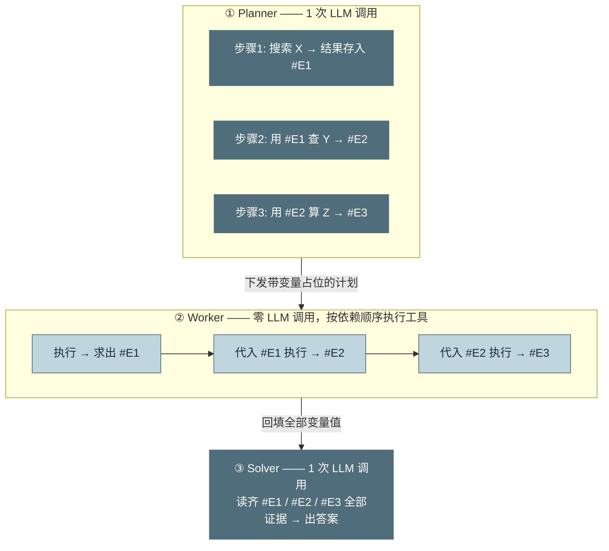
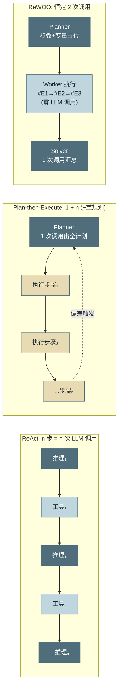
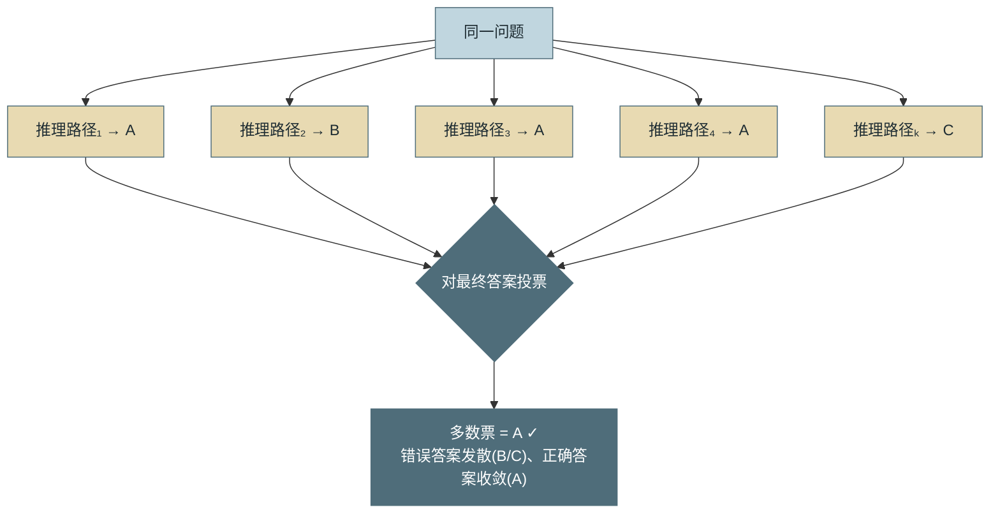
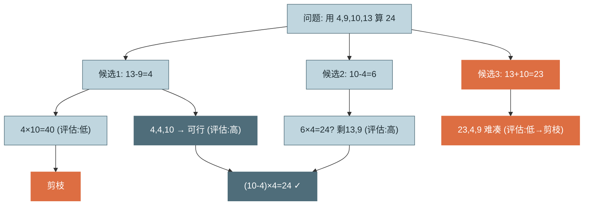
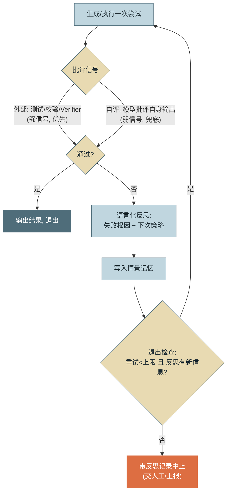
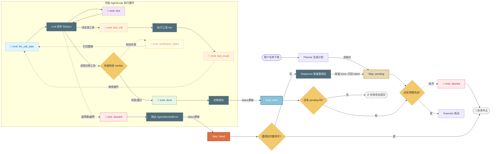

# 第4章 规划和推理

## 1. 场景引入

示例助手接到一个新任务类型：月度合规审计——遍历 12 个数据源（工单库、发布记录、权限变更日志……），逐一检查三条合规规则，汇总成审计报告。工程师直接复用第
3 章的 ReAct 循环上线，预算给足，结果第一次试运行就暴露了问题。

轨迹显示：模型前 5 轮表现正常，逐个数据源检查；第 8 轮开始出现**状态漂移**——它重复检查了已经查过的发布记录（历史太长，早期观察被注意力稀释），第
14 轮又跳过了两个尚未检查的数据源直接开始写报告。最终报告覆盖了 12 个源中的 9
个，且没人能从报告本身看出缺了哪三个。费用方面同样难看：每轮都背着全量历史推理"下一步查哪个"，而这个决策本可以在任务开始时一次性做完——12
个源的检查彼此独立，完全可以并行。

问题的本质：**ReAct 的计划是隐式的**——"接下来做什么"
分散在每一轮的即时推理里，没有任何一个地方存在一份可核对的清单。对路径不可预知的探索型任务，这种"边走边想"
是优势（每一步都基于最新观察）；对结构清晰、可预先分解的任务，它同时输掉了成本、并行度和完备性。本章把"计划以什么形态存在"
变成一个显式的架构决策。

## 2. 原理

### 2.1 规划谱系：计划存在于哪里

按"计划的显式化程度"排列，四种取向构成一条谱系：

- **取向一：隐式规划（CoT，Chain-of-Thought）**。 计划只存在于模型的**思维链**里——每轮推理时模型临时想"下一步做什么"
  ，想完即弃。ReAct 就是隐式规划的循环化。优点：零额外调用成本、每步都基于最新观察（纠错能力最强）；缺点：计划不可见、不可审计、不可持久——长任务下必然漂移（场景引入的病灶），且步骤只能串行发现、无法并行。

- **取向二：显式规划（Plan-then-Execute）**。 先用一次专门的**规划调用（Planner）** 产出结构化步骤清单，再由 **执行器（Executor）** 逐步执行。计划成为一等公民：可展示给用户确认、可持久化断点续跑、可静态分析依赖以并行执行无依赖步骤。代价：多一次规划调用；且计划基于零观察做出，环境与预期不符时需要 **重规划（Replanning）** 机制兜底。这一取向在文献与社区里也常被称作 Plan-and-Solve（Wang 等人 2023 年在纯推理任务上提出的同名提示范式 [C-23]）——名字不同，"先全局规划、再分步执行"的骨架相同，检索资料时可互为线索。

- **取向三：TODO List 驱动**。 显式规划的工程化变体，也是 2025 年后 Coding Agent 的主流形态（Claude Code 的 TodoWrite
  即此）：计划不是一次性产物，而是一份**由模型通过工具持续读写的活文档**——每轮循环把当前 TODO 状态注入上下文，模型执行中可以勾选、追加、改写条目。它在谱系上介于一和二之间：保留了 ReAct 的逐步纠错，又把"还剩什么没做"从易失的注意力搬进了稳定的结构化状态，直接治愈状态漂移。代价是每轮上下文多一份 TODO 视图，以及工具读写的少量轮次开销。

- **取向四：解耦规划（ReWOO，Reasoning WithOut Observation）**。 Xu 等人 2023 年提出的激进形态：Planner **一次性**
  生成全部步骤，步骤间用变量占位符串联（步骤 3 的输入引用步骤 1 的输出 #E1）；Worker 按依赖图执行工具，**全程不调用 LLM**；最后 Solver 用一次调用汇总全部证据出答案。整个任务只有 **2 次 LLM 调用**（Planner + Solver），且历史不随步数累积——论文在  HotpotQA 上以约 1/5 的 token 消耗达到超过 ReAct 的准确率。代价是纠错能力归零：免观察执行意味着任何中间结果偏离预期，后续步骤都会拿着错误变量继续跑，直到 Solver 阶段才暴露。同族近亲 **LLMCompiler**（Kim 等，2023）把这一思路推向并行：Planner 产出带依赖关系的任务 DAG，无依赖的工具调用并发执行——省调用之外再赢延迟。





三维权衡框架汇总（这张表是本章的选型工具）：

| 维度       | 隐式（CoT/ReAct）   | 	显式（P2E / TODO 驱动）                | 解耦（ReWOO）                  |
|----------|-----------------|-----------------------------------|----------------------------|
| token 成本 | 	高：n 次调用 × 递增历史 | 	中：1 次规划 + n 次轻执行；TODO 版另加每轮清单视图	 | 最低：恒定 2 次调用，历史不累积          |
| 并行度      | 	无：下一步依赖上一步观察   | 	高：计划期可静态分析依赖，无依赖步骤并行             | 	最高：依赖图显式，Worker 层自由并行     |
| 纠错能力     | 	最强：每步基于最新观察    | 	中：靠重规划触发，有一步延迟                   | 	最弱：免观察执行，错误传播到 Solver 才暴露 |
| 适用形态     | 	探索型：路径不可预知     | 	可分解型：结构清晰但步骤内有变数                 | 流水线型：路径稳定、工具可靠             |

### 2.2 搜索式推理：把一条思路变成一棵树

规划解决"步骤怎么排"，搜索式推理解决另一个问题："当单条推理路径不可靠时，如何用多条路径换取正确率"。

**自洽性采样（Self-Consistency）**：同一问题独立采样 k 条推理路径，对**最终答案**投票取多数。Wang 等人 2022 年的结果：GSM8K 数学题上比单路径 CoT 提升 17.9 个百分点 [C-01]。成本是线性的 k 倍，收益来自一个统计事实——推理错误路径的答案是发散的，正确路径的答案是收敛的。



**思维树（ToT，Tree of Thoughts）**：把推理组织成树——每个节点是一个中间思考状态，向下扩展多个候选，用**评估器**（模型自评或规则）给节点打分，剪掉低分支，按 BFS/DFS 搜索。Yao 等人 2023 年的标志性结果：24 点游戏上 GPT-4 单路径 CoT 成功率 4%，ToT 达到 74% [C-02]——差距来自任务本身需要"试错回溯"，而线性推理不具备回头能力。




适用边界必须说清楚：**搜索式推理适合离散决策，不适合开放生成**。投票需要"答案可比较"——数学结果、多选项、SQL 语句、路由决策都行；而"写一份审计报告"没有多数可投（k 份报告两两不同），ToT 的评估器也难以给开放文本打出可比的分。开放生成任务若要多路径，正确形态是 **best-of-n + 评审器（Judge）选优**。另一个现代注脚：**扩展思考（Extended Thinking）在相当程度上内化了搜索**——推理型模型在思考过程中自行尝试、回溯、验证，2023 年需要手工搭 ToT 脚手架才能获得的收益，如今相当部分由模型原生提供。手工搜索式推理如今的价值区间收窄为：高价值、离散、且需要跨调用并行采样的决策点。

### 2.3 反思机制：批评-重试闭环

反思（Reflection）是五要素中最后就位的一块，机制上是一个**批评-重试循环**。两个代表性设计的区别在于**批评信号的来源**：

- **Self-Refine**（Madaan 等，2023）：同一模型分饰三角——生成 → 自我批评 → 依批评修订，循环直至自评通过。零外部依赖，适合纯文本产物的打磨；弱点也在"自"字上：模型对自己输出的批评与生成共享同一套盲区，改进有天花板，且容易出现"表面修订"（换措辞不换实质）。

- **Reflexion**（Shinn 等，2023）：批评信号来自**外部环境**——测试失败、校验报错、任务超时。失败后模型做一次**语言化反思**（"失败是因为我假设了 X，下次应先检查 Y"），反思文本存入**情景记忆**，下次尝试时注入上下文。论文在 HumanEval 代码生成上把 GPT-4 从 80% 提升到 91%——增量正来自"外部信号 + 跨尝试记忆"两个自评不具备的要素。



与评测体系的结合是反思机制的生产化关键：**Eval 断言就是最好的外部批评信号源**。离线评测里积累的校验器（Schema 检查、业务规则断言、单元测试）可以直接复用为在线反思的 `Verifier`——同一份断言，离线用来度量版本质量，在线用来驱动当次重试。这样反思不再依赖模型自评的弱信号，且断言的每次在线失败又回流成评测集的新用例，形成闭环。

### 2.4 任务分解与重规划出发

显式规划的成败一半在分解质量，一半在**重规划时机**。分解的三条实操原则：每步有独立的**完成判据**（可被 `Verifier` 检查）；步骤粒度对齐"执行器的一次小循环能完成"（经验值 3–8 轮）；显式标注步骤间依赖（并行调度与 ReWOO 变量串联的前提）。

重规划不能靠模型"觉得不对劲"——那又回到概率信号。生产系统监听三类确定性触发信号：
- **连续失败**：同一步骤失败 ≥ N 次（N 通常取 2）。一次失败可能是抖动，交给内循环重试；连续失败说明计划对这一步的假设错了，属于外循环层面的问题。
- **环境变化**：执行中的观察与计划前提矛盾——计划假设接口 A 可用而它已下线、假设文件存在而它没有。识别方式是把计划的关键假设写成谓词随步骤携带，执行器逐步校验。
- **预算-进度失衡**：预算消耗过半而完成步骤不足一半（数据都在 LoopState 与步骤状态里，一个除法就能算）。这是三类信号中最"分布式系统直觉"的一个——本质是 SLO 燃尽率告警在 Agent 上的翻版。

重规划的正确姿势是**增量**的：已完成步骤保留（沉没成本已付，结果是资产），把失败记录与剩余目标一起交回 Planner，只重排剩余工作。全量推倒重来会丢弃已验证的进展，还可能在同一个坑里再摔一次。

### 2.5 Extended Thinking：推理预算的成本收益曲线

现代模型把"想多久"变成了 API 参数（自适应思考 + 档位控制）。工程视角需要建立的是**成本收益曲线**的直觉：思考 token 的边际收益是**先陡后平、任务相关**的。
- 简单任务（分类、抽取、格式转换）：曲线几乎从零开始就平了——多想不提升正确率，纯付费。低档位甚至关闭思考是正解。
- 复杂推理（多约束规划、代码调试、数学）：曲线前段很陡——从无思考到中等思考，正确率可提升数十个百分点；随后进入平台期，继续加预算收益趋近于零，偶尔还会过度思考（在已正确的答案上反复自疑改错）。
- Agent 场景的特殊性：思考发生在每一轮，成本随轮数放大。合理配置是不对称的——Planner/反思这类"一次决策影响全局"的调用给高档位，执行器的机械轮次给低档位。显式规划把"值得深思的决策"集中到了少数调用上，恰好为差异化思考预算创造了结构。

一条实用的调参路径：从中档开始，用测集对比相邻档位的"正确率增量 / 成本增量"，增量比低于业务阈值就停——这条曲线必须用自己的任务量出来，论文数字只能定性参考。

## 3. 手动实现



```
  ==== 启动 Plan-then-Execute ====

[Planner] 正在拆解任务: 请先列出当前目录下的所有文件名，然后读取 README.md，最后写一份 200 字以内的 summary.md
  -> 步骤 1: 列出当前目录下的所有文件名（含隐藏文件，标注是否为目录），确认 README.md 是否存在 (完成判据: 输出一份完整的条目清单（文件名 + 类型），并对 README.md 的存在性给出明确结论)
  -> 步骤 2: 读取 README.md 的完整内容（若体积过大则分段读完），不做截断 (完成判据: 获得 README.md 全文内容；若文件不存在或为空，则明确记录该结论并在此处终止并向用户确认后续处理)
  -> 步骤 3: 从 README.md 中提炼结构化要点：项目名称与用途、安装/依赖、使用方式或常用命令、目录结构说明、注意事项与许可证 (完成判据: 得到要点清单，且每一条都能对应到 README.md 的原文章节，无外部推测内容)
  -> 步骤 4: 依据要点清单撰写 summary.md 草稿，语言与 README 主体语言一致，控制在 200 字以内，只保留关键信息 (完成判据: 草稿成文且字数统计 ≤200（按汉字/字符计，去除空白与标题标记后计数），要点覆盖率与第 3 步清单一致)
  -> 步骤 5: 将草稿写入当前目录的 summary.md，并回读该文件校验 (完成判据: summary.md 创建成功，回读内容与草稿完全一致，且回读后再次确认字数 ≤200)
  -> 步骤 6: 向用户汇报：文件清单概况、README.md 核心要点、summary.md 最终正文 (完成判据: 回复中同时包含三项内容，并说明是否存在无法识别的文件或内容缺失)

[Executor] 开始执行步骤 1: 列出当前目录下的所有文件名（含隐藏文件，标注是否为目录），确认 README.md 是否存在
      --- 执行器 第 1 轮思考 ---
      🛠️ 决定调用工具: list_files
      👀 工具结果 (✅): .env
.git
.gitignore
.idea
LICENSE
README.md
docs
examples
main.py
pyproject.tom...
      --- 执行器 第 2 轮思考 ---
      ✅ 提交成功，当前步骤执行完毕。
✅ 步骤 1 完成

[Executor] 开始执行步骤 2: 读取 README.md 的完整内容（若体积过大则分段读完），不做截断
      --- 执行器 第 1 轮思考 ---
      🤖 执行器说: 我先读取 README.md 的完整内容。...
      🛠️ 决定调用工具: read_file
      👀 工具结果 (✅): 【文件元数据】总字符数：17

【正文内容】
# agent-assistant...
      --- 执行器 第 2 轮思考 ---
      🤖 执行器说: README.md 已读取完毕。文件存在，但内容极短（仅 17 字符）。...
      ✅ 提交成功，当前步骤执行完毕。
✅ 步骤 2 完成

[Executor] 开始执行步骤 3: 从 README.md 中提炼结构化要点：项目名称与用途、安装/依赖、使用方式或常用命令、目录结构说明、注意事项与许可证
      --- 执行器 第 1 轮思考 ---
      🤖 执行器说: 我已读取到步骤1、2的进展信息：README.md 全文仅为 `# agent-assistant`...
      🛠️ 决定调用工具: read_file
      👀 工具结果 (✅): 【文件元数据】总字符数：17

【正文内容】
# agent-assistant...
      --- 执行器 第 2 轮思考 ---
      🤖 执行器说: 已确认 README.md 全文内容仍为 `# agent-assistant`（17 字符，仅一行...
      ✅ 提交成功，当前步骤执行完毕。
✅ 步骤 3 完成

[Executor] 开始执行步骤 4: 依据要点清单撰写 summary.md 草稿，语言与 README 主体语言一致，控制在 200 字以内，只保留关键信息
      --- 执行器 第 1 轮思考 ---
      🤖 执行器说: 我会查看工作区，确认当前状态，然后撰写 summary.md 草稿。...
      🛠️ 决定调用工具: list_files
      👀 工具结果 (✅): .env
.git
.gitignore
.idea
LICENSE
README.md
docs
examples
main.py
pyproject.tom...
      🛠️ 决定调用工具: read_file
      👀 工具结果 (✅): 【文件元数据】总字符数：17

【正文内容】
# agent-assistant...
      --- 执行器 第 2 轮思考 ---
      🛠️ 决定调用工具: write_file
      👀 工具结果 (✅): 文件已写入 summary.md (251 字符)...
      --- 执行器 第 3 轮思考 ---
      🛠️ 决定调用工具: read_file
      👀 工具结果 (✅): 【文件元数据】总字符数：251

【正文内容】
# agent-assistant

## 要点
- **项目名称**：agent-assistant（READ...
      --- 执行器 第 4 轮思考 ---
      🛠️ 决定调用工具: write_file
      👀 工具结果 (✅): 文件已写入 summary.md (183 字符)...
      --- 执行器 第 5 轮思考 ---
      ✅ 提交成功，当前步骤执行完毕。
✅ 步骤 4 完成

[Executor] 开始执行步骤 5: 将草稿写入当前目录的 summary.md，并回读该文件校验
      --- 执行器 第 1 轮思考 ---
      🤖 执行器说: 我会把草稿写入 summary.md，然后回读校验。...
      🛠️ 决定调用工具: write_file
      👀 工具结果 (✅): 文件已写入 summary.md (183 字符)...
      --- 执行器 第 2 轮思考 ---
      🛠️ 决定调用工具: read_file
      👀 工具结果 (✅): 【文件元数据】总字符数：183

【正文内容】
# agent-assistant

## 要点
- 项目名称：agent-assistant（README 唯...
      --- 执行器 第 3 轮思考 ---
      ✅ 提交成功，当前步骤执行完毕。
✅ 步骤 5 完成

[Executor] 开始执行步骤 6: 向用户汇报：文件清单概况、README.md 核心要点、summary.md 最终正文
      --- 执行器 第 1 轮思考 ---
      🤖 执行器说: 我将先回读 summary.md 确认最终正文，再向用户汇报。...
      🛠️ 决定调用工具: read_file
      👀 工具结果 (✅): 【文件元数据】总字符数：183

【正文内容】
# agent-assistant

## 要点
- 项目名称：agent-assistant（README 唯...
      🛠️ 决定调用工具: list_files
      👀 工具结果 (✅): .env
.git
.gitignore
.idea
LICENSE
README.md
docs
examples
main.py
pyproject.tom...
      --- 执行器 第 2 轮思考 ---
      🤖 执行器说: 校验完成，现向用户汇报。

---

## 一、文件清单概况

当前工作区根目录（`.`）共 **1...
      ✅ 提交成功，当前步骤执行完毕。
✅ 步骤 6 完成


==== 最终交付报告 ====
## 步骤 1: 列出当前目录下的所有文件名（含隐藏文件，标注是否为目录），确认 README.md 是否存在
当前目录（工作区根目录 "."）条目清单如下（共 11 项）：

| 序号 | 名称 | 类型 |
|---|---|---|
| 1 | .env | 文件（隐藏文件，环境变量配置） |
| 2 | .git | 目录（隐藏目录） |
| 3 | .gitignore | 文件（隐藏文件） |
| 4 | .idea | 目录（隐藏目录，IDE 配置） |
| 5 | LICENSE | 文件 |
| 6 | README.md | 文件 |
| 7 | docs | 目录 |
| 8 | examples | 目录 |
| 9 | main.py | 文件 |
| 10 | pyproject.toml | 文件 |
| 11 | src | 目录 |

其中目录 4 个：.git、.idea、docs、examples；文件 7 个：.env、.gitignore、LICENSE、README.md、main.py、pyproject.toml（及隐藏项已计入）。

关于隐藏文件的说明：list_files 工具返回结果中包含了以 "." 开头的条目（.env、.git、.gitignore、.idea），因此隐藏项已覆盖；但该工具不返回类型信息与文件大小，上述"文件/目录"的划分是依据命名惯例（如 .git/.idea/docs/examples/src 为目录，带扩展名或无扩展名的 LICENSE 为文件）推断的，未能通过独立工具（如 stat/ls -l）二次核验。

明确结论：README.md 存在，位于当前目录根下，为普通文件（非目录）。

## 步骤 2: 读取 README.md 的完整内容（若体积过大则分段读完），不做截断
已读取 README.md 全文，无需分段（文件极小）。

【元数据】总字符数：17，未被截断，已完整获取。

【正文全文（逐字符如实记录）】
# agent-assistant

（说明：内容为一行 Markdown 一级标题，文本为 "agent-assistant"，后接一个换行符，无其他任何章节、说明、徽章或代码块。）

【结论判定】
- 文件存在：是，位于工作区根目录 ./README.md。
- 是否为空：否，严格意义上非空（含 17 个字符）。但实质上仅有一个标题行，不含任何项目说明、安装/使用说明、目录结构或贡献指南等实质内容，可视为"近乎空壳"的占位 README。
- 完成判据达成情况：已获得全文内容，判据满足。因文件非空，未触发"不存在或为空则终止"的终止分支。

【需向用户确认的后续处理建议】
当前 README 仅有标题，缺少实质信息。若后续大计划包含"补全/规范化 README"的步骤，可基于仓库实际内容（已知存在 main.py、pyproject.toml、src/、docs/、examples/、LICENSE、.env、.gitignore）撰写完整文档；但本步骤目标仅为"读取全文"，故未做任何修改，也未在磁盘上创建任何临时文件。

## 步骤 3: 从 README.md 中提炼结构化要点：项目名称与用途、安装/依赖、使用方式或常用命令、目录结构说明、注意事项与许可证
已从 README.md 提炼结构化要点。README.md 全文仅 17 字符、一行一级标题「# agent-assistant」，无任何其他章节。

要点清单（每条均标注原文对应关系，无外部推测）：
1. 项目名称 = agent-assistant —— 对应原文唯一章节：一级标题「# agent-assistant」。
2. 项目用途 —— README.md 中【无对应章节】，原文缺失，不作推测。
3. 安装/依赖 —— README.md 中【无对应章节】，原文缺失，不作推测。
4. 使用方式/常用命令 —— README.md 中【无对应章节】，原文缺失，不作推测。
5. 目录结构说明 —— README.md 中【无对应章节】，原文缺失，不作推测。
6. 注意事项 —— README.md 中【无对应章节】，原文缺失，不作推测。
7. 许可证 —— README.md 正文【未提及】，原文缺失；工作区另有独立 LICENSE 文件，但该信息不来自 README.md，故未纳入要点。

结论：五类要求中仅「项目名称」可对应到原文（唯一标题行），其余各项在 README.md 中确无对应内容，已如实标注为缺失，符合「无外部推测内容」的完成判据。本步骤未修改任何文件，也未创建临时文件。

## 步骤 4: 依据要点清单撰写 summary.md 草稿，语言与 README 主体语言一致，控制在 200 字以内，只保留关键信息
已完成 summary.md 草稿撰写（写入工作区根目录 ./summary.md）。

【语言一致性】README.md 主体语言为中文语境下的英文标题「# agent-assistant」，无任何正文语句；因要点内容需用自然语言表达，草稿采用中文撰写，项目名称保留英文原名 agent-assistant，与 README 的命名保持一致，未引入 README 中不存在的英文术语。

【草稿全文】
# agent-assistant

## 要点
- 项目名称：agent-assistant（README 唯一内容，即一级标题）。
- 项目用途：未说明。
- 安装/依赖：未说明。
- 使用方式/常用命令：未说明。
- 目录结构：未说明。
- 注意事项：未说明。
- 许可证：未提及。

## 结论
README 仅有一行标题，实质内容缺失，建议补全以上各项。

【字数统计】文件总字符数 183（含标题标记、空白与换行）；去除空白与标题标记（#、##、- 及空格换行）后有效计数约 150 字符，满足 ≤200 的判据。首版草稿曾达 251 字符，已通过精简括注与冗余表述压缩至 183，二次写入后重新读取校验确认。

【要点覆盖率核对（与第 3 步清单逐条对应）】
1. 项目名称 → 已覆盖（agent-assistant，标注来源为唯一一级标题）。
2. 项目用途 → 已覆盖（标注"未说明"，与第 3 步"原文缺失、不作推测"一致）。
3. 安装/依赖 → 已覆盖（"未说明"）。
4. 使用方式/常用命令 → 已覆盖（"未说明"）。
5. 目录结构说明 → 已覆盖（"未说明"）。
6. 注意事项 → 已覆盖（"未说明"）。
7. 许可证 → 已覆盖（"未提及"；未把独立 LICENSE 文件的信息混入，与第 3 步口径一致）。
覆盖率 7/7，无新增、无删减、无外部推测内容。

【其他说明】本次仅生成任务明确要求的交付物 summary.md，未创建任何其他临时文件，未修改 README.md 及仓库内任何既有文件。

## 步骤 5: 将草稿写入当前目录的 summary.md，并回读该文件校验
已完成 summary.md 的写入与回读校验。

【写入】使用 write_file 将第 4 步草稿原文写入工作区根目录 ./summary.md，工具返回"文件已写入 summary.md (183 字符)"。

【回读校验】使用 read_file 回读 ./summary.md，结果：
- 元数据：总字符数 183，未被截断。
- 正文与草稿逐行比对完全一致（标题「# agent-assistant」、小节「## 要点」下 7 条要点、「## 结论」及一行结论），无任何字符差异、无缺失或多余行。

【字数校验】回读确认总字符数 183，满足 ≤200 的判据（含标题标记、空白与换行）。

【完成判据核对】
1. summary.md 创建成功 —— 是，位于 ./summary.md。
2. 回读内容与草稿完全一致 —— 是，逐行一致。
3. 回读后再次确认字数 ≤200 —— 是，183 字符。

【其他】本次仅生成任务明确要求的交付物 summary.md，未创建任何其他临时文件，未修改 README.md 及仓库内任何既有文件。

## 步骤 6: 向用户汇报：文件清单概况、README.md 核心要点、summary.md 最终正文
已向用户完成汇报，三项内容齐备，并说明了无法识别项与内容缺失情况。

【一、文件清单概况】工作区根目录共 12 项（含本次新建的 summary.md）：隐藏项 .env（文件）、.git（目录）、.gitignore（文件）、.idea（目录）；普通项 LICENSE（文件）、README.md（文件）、docs（目录）、examples（目录）、main.py（文件）、pyproject.toml（文件）、src（目录）、summary.md（文件，新建交付物）。目录 5 个、文件 8 个。

【二、README.md 核心要点】全文仅 17 字符，唯一内容为一级标题「# agent-assistant」。要点提炼：项目名称=agent-assistant（唯一可对应原文项）；项目用途、安装/依赖、使用方式/常用命令、目录结构说明、注意事项——原文均缺失、未说明；许可证——README 正文未提及（工作区另有独立 LICENSE 文件，但信息不来自 README，未混入）。

【三、summary.md 最终正文（183 字符，回读校验与草稿逐行一致）】
# agent-assistant

## 要点
- 项目名称：agent-assistant（README 唯一内容，即一级标题）。
- 项目用途：未说明。
- 安装/依赖：未说明。
- 使用方式/常用命令：未说明。
- 目录结构：未说明。
- 注意事项：未说明。
- 许可证：未提及。

## 结论
README 仅有一行标题，实质内容缺失，建议补全以上各项。

【四、无法识别项与内容缺失】无法识别的文件/内容：无，12 项均可明确归类，无乱码或未知扩展名条目。判定局限：list_files 不返回类型与大小，文件/目录划分依据命名惯例推断，未经 stat/ls -l 二次核验。内容缺失：README 除标题外六类实质信息全部缺失，属占位空壳文档；.env 与 .idea/ 内容未读取（本步骤未要求，且 .env 通常含敏感信息）；仓库已有 pyproject.toml、src/、docs/、examples/、LICENSE 等实体但 README 未做任何关联说明，文档与代码现状脱节。建议后续文档规范化步骤基于实际结构补全六个缺失章节。

本次仅维护任务要求的交付物 summary.md，未创建任何其他临时文件，未修改 README.md 及仓库既有文件。

```